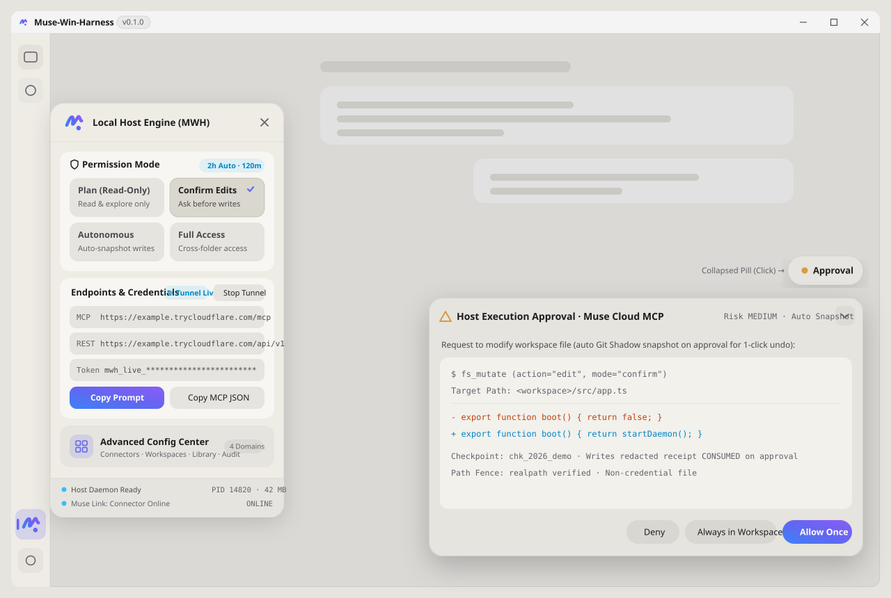

<p align="center">
  
</p>

<p align="center">
  <a href="./README.md"><b>English</b></a> |
  <a href="./docs/readme/README_zh.md">简体中文</a> |
  <a href="./docs/readme/README_zh-TW.md">繁體中文</a> |
  <a href="./docs/readme/README_ja.md">日本語</a> |
  <a href="./docs/README.md">Docs Map</a>
</p>

<p align="center">
  <a href="./CHANGELOG.md"></a>
  <a href="./LICENSE"></a>
  
  = 22">
  <a href="./docs/SECURITY_DISCLOSURE.md"></a>
  <a href="./DISCLAIMER.md"></a>
</p>

**Cloud AI is great at thinking, but stuck in a browser tab. Muse-Win-Harness (MWH) gives [Muse](https://muse.ai) (or any MCP / REST client) a pair of hands on your Windows PC — while keeping the brakes in yours.**

No WSL2, no Docker, no virtual machine setup. MWH wraps `muse.ai` in a clean native Windows companion window, exposes a local tool bridge over standard MCP (`/mcp`) and REST (`/api/v1`), fences file access to the folders you authorize, saves an automatic undo snapshot before every file edit, and pops up a live desktop floating island whenever an action needs your nod.

> [!IMPORTANT]
> **Honest Boundaries & Vibe Coding Disclosure (`v0.1.0` Early Preview)**
>
> 1. **No OS-Kernel Sandbox (`无 OS 级真沙箱，依赖路径围栏+进程树管控+审批流`)**: MWH runs under your normal Windows user account. Instead of virtualization, it relies on physical path fencing, process-tree termination (Win32 Job Objects), pre-write snapshots, and human-in-the-loop approvals. See the full [Security Disclosure](./docs/SECURITY_DISCLOSURE.md).
> 2. **Born from Vibe Coding**: This project was built through **vibe coding / AI-assisted iterative engineering** alongside automated verification gates. AI-assisted code can still have blind spots—please review destructive commands before clicking approve, keep backups of critical work, and read [`DISCLAIMER.md`](./DISCLAIMER.md).

## Table of Contents

- [What It Feels Like to Use](#what-it-feels-like-to-use)
- [Inside the Companion Window](#inside-the-companion-window)
- [Quick Start & 3-Step Pairing](#quick-start--3-step-pairing)
- [Tools Reference (7 Default + 1 Optional)](#tools-reference-7-default--1-optional)
- [Four Permission Gears](#four-permission-gears)
- [Known Limitations](#known-limitations)
- [Documentation & Disclaimer](#documentation--disclaimer)

## What It Feels Like to Use

<table>
  <tr>
    <td width="50%" valign="top">
      <b>Four clear gears, from "just look" to "hands-free".</b><br>
      Switch modes in one click from the left sidebar drawer: <code>plan</code> (read-only exploration), <code>confirm</code> (asks before changing files — the default), <code>autonomous</code> (auto-snapshots and runs inside your workspace), or <code>full-access</code> (cross-folder access with a 2-hour auto-downgrade timer). High-risk actions like <code>rm -rf</code>, <code>git push --force</code>, or touching <code>.env*</code> / <code>~/.ssh</code> always stop and ask you first.
    </td>
    <td width="50%" valign="top">
      <b>Approve on the desktop, not by typing in chat.</b><br>
      When the AI wants to edit a file or run a command, a floating island pops up at the bottom-right of your window showing the exact path and diff. Click <i>Approve Once</i> and the local daemon executes the task and hands the receipt straight back to Muse — no need to type "approved" in the chat box.
    </td>
  </tr>
  <tr>
    <td width="50%" valign="top">
      <b>Every file change has a 1-click undo button.</b><br>
      Before MWH writes, edits, moves, or deletes anything, it captures a lightweight workspace snapshot (including untracked and CJK-named files) under <code>.mwh/checkpoints/</code>. Open the <i>Audit</i> tab anytime to roll back a single step with integrity verification.
    </td>
    <td width="50%" valign="top">
      <b>When you hit Stop, the whole process tree stops.</b><br>
      Background PowerShell tasks and local coding agents run silently without flashing black console windows. Clicking <i>Kill</i> on the floating island terminates that task and every child process it spawned; <i>Global Emergency Stop</i> clears all running jobs, active loops, and pending approvals at once.
    </td>
  </tr>
  <tr>
    <td width="50%" valign="top">
      <b>Plug in your own local ACP coding agents.</b><br>
      Have a local coding CLI that speaks the Agent Client Protocol (JSON-RPC 2.0 over stdio)? Add it in the <i>Subagents</i> tab. MWH automatically caps its permissions to never exceed your current mode and can isolate its edits inside a dedicated <code>git worktree</code> branch.
    </td>
    <td width="50%" valign="top">
      <b>Checks the engine before opening the window.</b><br>
      Double-clicking <code>MWH启动.cmd</code> verifies that the local daemon on <code>127.0.0.1:19820</code> is healthy and authenticated before opening the desktop window. If the daemon ever disconnects, the top bar tells you plainly instead of pretending to be ready.
    </td>
  </tr>
</table>

## Inside the Companion Window

<p align="center">
  
</p>

<p align="center">
  <sub>示意图</sub>
</p>

- **Left Sidebar Drawer (Quick Controls)**: Flush against the left navigation rail. Lets you switch between the 4 permission gears, start or stop a Cloudflare Quick Tunnel, copy your MCP endpoint / Bearer Token / pairing prompt, or open the 5-tab **Advanced Configuration Center** (`Connectors` · `Permissions` · `Workspaces` · `Subagents` · `Audit & Snapshots`).
- **Bottom-Right Approval Floating Island**: Stays tucked away as a compact status pill when idle, expands automatically when a task needs your approval or is actively running, and can be dragged anywhere inside the window.

## Quick Start & 3-Step Pairing

### 1. Prerequisites & Build

- **OS**: Windows 10 or Windows 11 (x64)
- **Runtime**: Node.js `>= 22.0.0` (pinned in [`.nvmrc`](./.nvmrc)) and Git in `PATH`

```powershell
# 1. Enable the repo pre-commit hook (prevents committing runtime-generated SKILL.md)
git config core.hooksPath .githooks

# 2. Install dependencies for backend, frontend debug UI, and Electron shell
npm ci
npm --prefix frontend ci
npm --prefix shell ci

# 3. Build frontend assets and TypeScript kernel
npm run build:ui
npm run build
```

### 2. Launch the Desktop Companion

Double-click [`MWH启动.cmd`](./MWH启动.cmd) in the repository root. It automatically checks (or starts) the local daemon on `127.0.0.1:19820` and opens the companion window.

*(Prefer running from a terminal? Run `npm start` in one PowerShell window and `npm --prefix shell start` in another.)*

### 3. Pair with Muse in 3 Steps (Full Guide in [`docs/PAIRING.md`](./docs/PAIRING.md))

1. **Start a Tunnel**: Click the **MWH** icon on the left sidebar, click **Start Public Tunnel** (Cloudflare Quick Tunnel), and copy the **MCP Endpoint** URL and **Bearer Token**.
2. **Add the Connector in Muse**: Create a custom MCP connector in Muse using that URL and Bearer Token *(never paste your real Bearer Token into the chat prompt)*, then click **Copy Pairing Prompt** in the MWH drawer and paste that key-free prompt into a **new** Muse chat.
3. **Verify the Handshake**: Ask Muse to call `pc_status`. Once it reports your current permission mode, workspace path, and tunnel state, you're live! *(If a temporary `*.trycloudflare.com` URL changes after a restart, just update the URL in your Muse connector—your token stays the same.)*

## Tools Reference (7 Default + 1 Optional)

MWH exposes **7 tools by default** over Streamable HTTP MCP (`/mcp`) and REST (`/api/v1/tools/:name`). An 8th desktop-automation tool (`desktop_hands`) stays completely hidden unless you explicitly enable it in `config.yaml`.

| Tool Name | Category | Default | What It Does & Supported `action` Values |
| :--- | :--- | :---: | :--- |
| `pc_status` | `read` | Yes | Checks host OS/CPU/RAM stats, active permission `profile`, tunnel status, `lastApprovalReceipt`, and configured ACP coding agents. |
| `fs_explore` | `read` | Yes | Reads and searches inside authorized folders: `read` (by line range), `list` (directory entries), `glob` (file matching), and `grep` (regex search). |
| `fs_mutate` | `write` | Yes | Automatically saves a pre-write snapshot, then performs file `write`, exact snippet `edit`, `move`, or `delete`. |
| `exec_command` | `sensitive_write` | Yes | Runs PowerShell commands silently (no console popup) inside a Win32 Job Object; long commands (`>8s`) automatically hand off to a background job. |
| `job_control` | `write` | Yes | Manages background jobs and approvals: `poll` output/receipts, stream `events`, `steer`, send `stdin`, `abort` process trees, `approve`/`reject`, or check `status`. |
| `subagent_dispatch` | `sensitive_write` | Yes | Dispatches local ACP coding agents or the built-in loop (`run`, `resume`, `events`, `wait`, `steer`, `interrupt`, `list`, `profiles`) within your current permission ceiling. |
| `git_checkpoint` | `write` | Yes | Manages workspace recovery points: `create` a snapshot, inspect `status` / `diff`, or `rollback` to a previous state. |
| `desktop_hands` | `sensitive_write` | Optional `[Experimental]` | DPI-aware screen capture and input (`screenshot`, `mouse_move`, `mouse_click`, `keyboard_type`). **Disabled and hidden by default**; requires `desktopHands.enabled: true`. |

## Four Permission Gears

Every mode and emergency kill path is continuously tested by automated verification gates (`npm run verify`). For the underlying technical mappings and error codes, see [`docs/SECURITY_DISCLOSURE.md`](./docs/SECURITY_DISCLOSURE.md).

| Permission Gear (`profile`) | Best For | Read in Workspace | Edit Files / Run Commands in Workspace | Outside Workspace Folders | `.env*` / `~/.ssh` & Destructive Commands (`rm -rf`, `push -f`) |
| :--- | :--- | :--- | :--- | :--- | :--- |
| **`plan`** *(Plan Only)* | Safe code review & architecture Q&A | Allowed | **Blocked** | **Blocked** | **Blocked** |
| **`confirm`** *(Default)* | Everyday pair-programming | Allowed | **Asks on Floating Island** | **Blocked** | Sensitive paths **Blocked**; destructive commands **Always Ask** |
| **`autonomous`** | Hands-free coding inside one repo | Allowed | **Auto-snapshot & Run** | **Blocked** | Sensitive paths **Blocked**; destructive commands **Always Ask** |
| **`full-access`** | Cross-folder tasks (auto-downgrades after 2h) | Allowed | **Auto-snapshot & Run** | **Allowed** (ordinary files) | **Always Asks for Single-Use Approval** (never bypassed) |

## Known Limitations

1. **Application-Layer Fencing, Not a Kernel VM**: MWH runs as your current Windows user without Hyper-V or WSL2 virtualization. Once you approve a script or command, it executes with your user privileges inside a Win32 Job Object ([`docs/SECURITY_DISCLOSURE.md`](./docs/SECURITY_DISCLOSURE.md)).
2. **External CLI Subagents**: Third-party coding CLIs launched via `subagent_dispatch` run as child processes. MWH enforces permission ceilings, optional Git worktree isolation, secret scrubbing, and process-tree termination, but cannot intercept internal OS syscalls inside third-party binaries.
3. **Windows UIPI on `desktop_hands` `[Experimental]`**: Even when `desktop_hands` is manually enabled, Windows User Interface Privilege Isolation prevents a standard-privilege MWH process from clicking or typing into Administrator (elevated) windows.
4. **Quick Tunnel Domain Rotation**: `Cloudflare Quick Tunnel` requires `cloudflared.exe` (checkable via `npm run doctor`) and assigns a new `*.trycloudflare.com` URL whenever the tunnel restarts. For a permanent URL, configure a Cloudflare Named Tunnel, Tailscale Funnel, or custom TLS reverse proxy in the drawer.
5. **Reserved OS-ACL Mode (`workspace-acl-experimental`)**: Reserved for future Windows restricted-token isolation and intentionally fails closed if requested in `v0.1.0`.

## Documentation & Disclaimer

| Document | What's Inside |
| :--- | :--- |
| [`docs/README.md`](./docs/README.md) | Complete documentation index |
| [`docs/readme/README_zh.md`](./docs/readme/README_zh.md) | Simplified Chinese full guide (简体中文完整说明) |
| [`docs/readme/README_zh-TW.md`](./docs/readme/README_zh-TW.md) | Traditional Chinese overview (繁體中文說明) |
| [`docs/readme/README_ja.md`](./docs/readme/README_ja.md) | Japanese overview (日本語ドキュメント) |
| [`docs/PAIRING.md`](./docs/PAIRING.md) | Step-by-step Muse pairing, quick-tunnel URL updates, and `401`/`403` recovery |
| [`docs/SECURITY_DISCLOSURE.md`](./docs/SECURITY_DISCLOSURE.md) | Full 4-gear × 8-action verified matrix, 3-layer emergency stop, SSRF rules, and residual risks |
| [`docs/UI.md`](./docs/UI.md) | Companion window architecture, drawer/subpanel layout, and inspection checklist |
| [`docs/ARCHITECTURE.md`](./docs/ARCHITECTURE.md) | Preflight chain, dual-protocol gateway, single-pipeline kernel, and ACP dispatcher |
| [`docs/ADR.md`](./docs/ADR.md) | Architecture Decision Records (ADR-001 through ADR-012) |
| [`DISCLAIMER.md`](./DISCLAIMER.md) | **Independent interoperability statement & Vibe Coding / AI-assisted development disclaimer** |

### Verification & Environment Doctor

If a tunnel or daemon fails to start, run `npm run doctor` to inspect the build, daemon port, token state, and `cloudflared` binary in one shot. To run the automated verification suites based on your local changes, use `npm run verify` (or `npm run test:ui-contract` and `npm run test:kernel-safety`).

### License & Independence

Licensed under the [Apache License, Version 2.0](./LICENSE). See [`CONTRIBUTING.md`](./CONTRIBUTING.md) and [`SECURITY.md`](./SECURITY.md) to contribute or report issues.

Muse-Win-Harness is an independent community project created via vibe coding / AI-assisted engineering, and is **not** affiliated with or endorsed by `muse.ai` or Meta Platforms, Inc.
