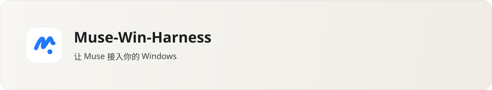

<p align="center">
  
</p>

<p align="center">
  <a href="../../README.md">English</a> |
  <a href="./README_zh.md">简体中文</a> |
  <a href="./README_zh-TW.md"><b>繁體中文</b></a> |
  <a href="./README_ja.md">日本語</a> |
  <a href="../README.md">文檔地圖</a>
</p>

<p align="center">
  <a href="../../CHANGELOG.md"></a>
  <a href="../../LICENSE"></a>
  
  = 22">
  <a href="../../DISCLAIMER.md"></a>
</p>

**雲端 AI 很擅長出主意，但困在瀏覽器分頁裡摸不到你的本機專案。Muse-Win-Harness (MWH) 為雲端 [Muse](https://muse.ai)（或任何標準 MCP / REST 客戶端）裝上一雙 Windows 本機手——同時把方向盤與煞車留在你手裡。**

無需安裝 WSL2、Hyper-V 或 Docker。MWH 提供清爽的原生桌面伴隨視窗與本機雙協議橋接器（`/mcp` + `/api/v1`）：只碰你授權的資料夾、每次修改檔案前自動保存「後悔藥」快照，遇到敏感操作時在視窗右下角彈出即時審批浮島，由你點頭才放行。

> [!IMPORTANT]
> **誠實安全邊界與 Vibe Coding 來源聲明（No Security Washing）**
>
> 1. **無 OS 級真沙箱，依賴路徑圍欄+進程樹管控+審批流**：MWH 運行於當前 Windows 使用者權限下，透過實體路徑圍欄、Win32 Job Object 處理程序樹強控、寫前快照與桌面人工審批守住邊界。完整實測矩陣請參閱 [`docs/SECURITY_DISCLOSURE.md`](../SECURITY_DISCLOSURE.md)。
> 2. **源於 Vibe Coding / AI 輔助開發**：本專案由開發者與編碼 Agent 透過 **Vibe Coding（AI 輔助迭代工程）** 協作完成並配合自動化門禁驗證。AI 輔助生成程式碼仍可能存在未預見的邊界問題，請務必妥善備份重要資料並參閱 [`DISCLAIMER.md`](../../DISCLAIMER.md)。

## 核心體驗亮點

- **四檔權限一鍵切換**：在左側欄 MWH 抽屜自由切換 `plan`（唯讀探查）、`confirm`（變更前彈窗確認，預設）、`autonomous`（授權工作區內自動留快照放行）、`full-access`（跨目錄讀寫 + 2 小時自動降級保護；`rm -rf`、`git push --force` 與 `.env*`/`~/.ssh` 永遠強制要求單次人工審批）。
- **右下角浮島即點即批**：在桌面右下角浮島點擊「允許一次」後立即執行並寫入脫敏回執，Muse 直接透過 `job_control(action="poll")` 取得結果，不必回聊天框打字確認。
- **寫前自動快照與整棵處理程序樹急停**：每次改檔前自動建立快照，支援按工作區單步一鍵回滾；「強殺」與「全域急停」可連同派生子孫程序一起終結，全程無黑框閃爍。

## 快速開始

```powershell
git config core.hooksPath .githooks
npm ci
npm --prefix frontend ci
npm --prefix shell ci
npm run build:ui
npm run build

# 雙擊 MWH啟動.cmd（自動完成本機守護進程預檢並開啟桌面視窗）
.\MWH启动.cmd
```

## 文檔導航

- **完整英文主文檔**：[`README.md`](../../README.md)
- **完整簡體中文主文檔（含介面詳解與工具表）**：[`docs/readme/README_zh.md`](./README_zh.md)
- **文檔總索引**：[`docs/README.md`](../README.md)
- **配對與排障指南**：[`docs/PAIRING.md`](../PAIRING.md)
- **架構設計、安全披露與免責聲明**：[`docs/ARCHITECTURE.md`](../ARCHITECTURE.md) · [`docs/SECURITY_DISCLOSURE.md`](../SECURITY_DISCLOSURE.md) · [`DISCLAIMER.md`](../../DISCLAIMER.md)

本專案採用 [Apache License 2.0](../../LICENSE) 授權，屬源於 Vibe Coding 的獨立開源社群專案，與 `muse.ai` 或 Meta Platforms, Inc. 無任何隸屬或背書關係。
