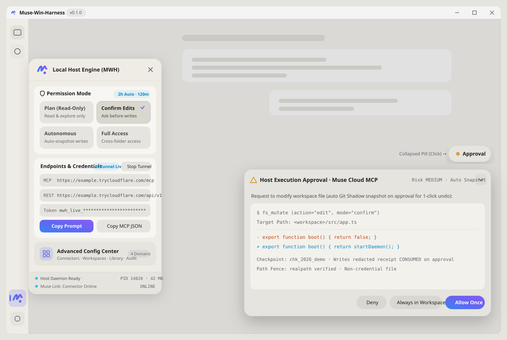

<p align="center">
  
</p>

<p align="center">
  <a href="../../README.md">English</a> |
  <a href="./README_zh.md"><b>简体中文</b></a> |
  <a href="./README_zh-TW.md">繁體中文</a> |
  <a href="./README_ja.md">日本語</a> |
  <a href="../README.md">文档地图</a>
</p>

<p align="center">
  <a href="../../CHANGELOG.md"></a>
  <a href="../../LICENSE"></a>
  
  = 22">
  <a href="../SECURITY_DISCLOSURE.md"></a>
  <a href="../../DISCLAIMER.md"></a>
</p>

**云端 AI 很擅长出主意，但困在浏览器网页里摸不到你的本地项目。Muse-Win-Harness (MWH) 给云端 [Muse](https://muse.ai)（或任何标准 MCP / REST 客户端）装上一双 Windows 本地手——同时把方向盘和刹车留在你手里。**

不用装 WSL2、不用开 Hyper-V 虚拟机、也不用配 Docker。MWH 用一个清爽的原生桌面伴随窗口承载 `muse.ai`，在本地搭起标准 MCP（`/mcp`）与 REST（`/api/v1`）桥接器：只允许访问你授权的文件夹，每次改文件前自动存好「后悔药」快照，遇到敏感改动或命令时在窗口右下角弹出实时审批浮岛，点一下才放行。

> [!IMPORTANT]
> **诚实安全边界与 Vibe Coding 来源声明（`v0.1.0` 早期预览版）**
>
> 1. **无 OS 级真沙箱（`无 OS 级真沙箱，依赖路径围栏+进程树管控+审批流`）**：MWH 运行在当前 Windows 登录用户下，并非虚拟机或内核容器。它依靠物理路径围栏、子进程树强杀（Win32 Job Object）、写前自动快照与桌面人工审批来守住边界；详细能力与残余风险请查阅《[安全边界如实披露表](../SECURITY_DISCLOSURE.md)》。
> 2. **源于 Vibe Coding / AI 辅助开发**：本项目由人类开发者与编码 Agent / 大语言模型通过 **Vibe Coding（AI 辅助迭代开发）** 共同构建，并配合自动化门禁验证核心链路。但 AI 生成代码与边缘场景仍可能存在疏漏，请勿在未备份的重要数据目录直接开启高权限模式，使用前请阅读《[免责声明 (`DISCLAIMER.md`)](../../DISCLAIMER.md)》。

## 目录

- [1. 它用起来是什么感觉](#1-它用起来是什么感觉)
- [2. 桌面窗口与操控面板一览](#2-桌面窗口与操控面板一览)
- [3. 三步快速上手与 Muse 配对](#3-三步快速上手与-muse-配对)
- [4. 暴露的本地工具箱 (7 默认 + 1 可选)](#4-暴露的本地工具箱-7-默认--1-可选)
- [5. 四档权限模式怎么选](#5-四档权限模式怎么选)
- [6. 已知限制（Known Limitations）](#6-已知限制known-limitations)
- [7. 文档导航与开源声明](#7-文档导航与开源声明)

## 1. 它用起来是什么感觉

<table>
  <tr>
    <td width="50%" valign="top">
      <b>四档权限，从「只看不改」到「放手干活」随时切。</b><br>
      打开左侧边栏抽屉即可一键切换：<code>plan</code>（计划模式，只读不改）、<code>confirm</code>（变更前确认，默认档，改文件或跑命令前弹窗问你）、<code>autonomous</code>（自主模式，工作区内常规修改自动留快照放行）、<code>full-access</code>（完全访问，开启 2 小时自动降级保护）。无论在哪一档，递归删库（<code>rm -rf</code>）、强制推送（<code>git push --force</code>）、磁盘格式化及敏感凭据目录（<code>.env*</code>、<code>~/.ssh</code>）永远强制要求你本人点头。
    </td>
    <td width="50%" valign="top">
      <b>桌面右下角点一下就批，不用回聊天框打「同意」。</b><br>
      需要你确认时，窗口右下角的审批浮岛会自动展开，清楚列出将要修改的文件路径、代码增删预览和风险等级。点击「<b>允许一次</b>」，本地守护进程立刻执行并把回执交给 Muse（通过 <code>job_control</code> 轮询拉取），全程不用切回对话框打字。
    </td>
  </tr>
  <tr>
    <td width="50%" valign="top">
      <b>每次动文件前先留快照，改坏了一键退回。</b><br>
      无论是新建、修改还是删除文件，MWH 都会先在 <code>.mwh/checkpoints/</code> 生成一份写前快照（完整支持未加入 Git 的新文件与中文文件名）。随时打开「审计」面板，按项目目录找到那一步点「<b>回滚此快照</b>」，就能干净还原。
    </td>
    <td width="50%" valign="top">
      <b>后台静默跑命令，点「强杀」整棵进程树一起停。</b><br>
      AI 调用的 PowerShell 脚本和本地代理全程在后台静默运行，不会接二连三弹出刺眼的黑框。点浮岛上的「强杀」会连同它派生的子孙进程一起终结；点「<b>全局急停</b>」则一次性清空所有运行中任务、内置循环与排队中的审批单。
    </td>
  </tr>
  <tr>
    <td width="50%" valign="top">
      <b>把你顺手的本地编码 Agent 接进来一起干。</b><br>
      本机装了支持 ACP 协议（Agent Client Protocol）的编码助手？在「代理」面板填好路径即可热接入。MWH 会自动给子代理套上权限天花板（绝不超过当前主档位），还能为它单独开辟 <code>git worktree</code> 隔离分支，改满意了再一键合并回主分支。
    </td>
    <td width="50%" valign="top">
      <b>开机先自检，连不上绝不装作「已就绪」。</b><br>
      双击 <code>MWH启动.cmd</code> 时，程序会先在后台核验本地守护进程（<code>127.0.0.1:19820</code>）与鉴权状态，通过后再打开桌面窗口；万一后台未启动或端口被占，窗口顶栏会直接亮起醒目提示条告诉你原因。
    </td>
  </tr>
</table>

## 2. 桌面窗口与操控面板一览

<p align="center">
  
</p>

<p align="center">
  <sub>示意图</sub>
</p>

- **左侧栏 MWH 快捷抽屉**：紧贴左侧导航栏展开。上半区提供**四档权限卡片（2×2 网格）**，中间提供**公网隧道开关、MCP/REST 端点与一键复制配对口令**，底部可一键呼出包含 5 个标签页的**高级配置中心**（`连接` · `权限` · `工作区` · `代理` · `审计`）。
- **右下角实时审批浮岛**：平时收起为一枚不挡视线的小胶囊（「待命 / 待授权」）；当有任务等待你批准或正在后台执行时自动展开，支持自由拖拽位置与单击折叠。

## 3. 三步快速上手与 Muse 配对

### 环境准备与首次构建

- **操作系统**：Windows 10 / Windows 11 (x64)
- **基础环境**：Node.js `>= 22.0.0`（根目录已附 [`.nvmrc`](../../.nvmrc)）与 Git

```powershell
# 1. 启用仓库 Git 钩子（防止误提交运行时生成的临时 SKILL.md）
git config core.hooksPath .githooks

# 2. 安装后端、前端调试页与桌面壳依赖
npm ci
npm --prefix frontend ci
npm --prefix shell ci

# 3. 编译前端资源与 TypeScript 后端
npm run build:ui
npm run build
```

### 启动与 Muse 配对三步法（详细排障见 [`docs/PAIRING.md`](../PAIRING.md)）

1. **双击启动并开启隧道**：双击仓库根目录的 [`MWH启动.cmd`](../../MWH启动.cmd) 打开桌面窗口 → 点击左侧栏 **MWH** 图标打开抽屉 → 点击 **拉起公网隧道**（Cloudflare Quick Tunnel），复制生成的 **MCP 端点**与 **Bearer Token**。
2. **在 Muse 中添加连接器**：进入 Muse 自定义连接器设置，填入刚才复制的 MCP URL 与 Bearer Token（**注意：永远不要把真实 Token 直接发进聊天框**）；随后回到 MWH 抽屉点击 **复制配对口令**，粘贴到一个**新开的** Muse 会话中。
3. **调用 `pc_status` 确认接通**：让 Muse 执行一次 `pc_status` —— 看到它准确报出你当前的权限档位、授权工作区路径和隧道状态，就说明已经稳稳接通！
   - *小贴士*：免费临时隧道（`*.trycloudflare.com`）每次重启会换一个新域名，重启后只需把新 URL 更新到 Muse 连接器里即可（Token 保持不变）。如果遇到 `401`/`403`，请照着 [`docs/PAIRING.md`](../PAIRING.md) 里的恢复步骤操作。

## 4. 暴露的本地工具箱 (7 默认 + 1 可选)

MWH 默认通过 `/mcp` 与 `/api/v1/tools/:name` 向云端暴露 **7 个正交核心工具**；第 8 个桌面键鼠自动化工具 `desktop_hands` 默认彻底隐藏，只有你在 `config.yaml` 中显式开启时才会注册。

| 工具名 | 类别 | 默认暴露 | 它是干什么的 & 支持的 `action` |
| :--- | :--- | :---: | :--- |
| `pc_status` | `read` | 是 | 查看本机系统与硬件状态、当前权限档位 (`profile`)、隧道连通状态、最近一次审批回执 (`lastApprovalReceipt`) 以及已接入的本地 ACP 代理。 |
| `fs_explore` | `read` | 是 | 在授权目录内安全查读文件：按行读取 (`read`)、列出目录 (`list`)、文件名匹配 (`glob`) 与正则全文搜索 (`grep`)。 |
| `fs_mutate` | `write` | 是 | 先自动保存写前快照，再执行文件写入 (`write`)、局部代码替换 (`edit`)、移动重命名 (`move`) 或删除 (`delete`)。 |
| `exec_command` | `sensitive_write` | 是 | 在后台无黑框运行 PowerShell 命令并纳入进程树管控；超过 8 秒的长耗时任务会自动转为后台作业。 |
| `job_control` | `write` | 是 | 管控后台任务与审批回执：分页拉取输出与审批结果 (`poll`)、增量事件流 (`events`)、运行中引导 (`steer`)、写入输入 (`stdin`)、强杀进程树 (`abort`)、批准/拒绝 (`approve`/`reject`) 与查状态 (`status`)。 |
| `subagent_dispatch` | `sensitive_write` | 是 | 派发并控制本地 ACP 编码代理或内置任务循环 (`run` / `resume` / `events` / `wait` / `steer` / `interrupt` / `list` / `profiles`)，自动受当前主权限档位封顶限制。 |
| `git_checkpoint` | `write` | 是 | 管理工作区快照检查点：手动创建快照 (`create`)、查看变更 (`status` / `diff`) 或一键还原到指定快照 (`rollback`)。 |
| `desktop_hands` | `sensitive_write` | 条件启用 `[Experimental]` | 桌面截屏与键鼠操作 (`screenshot` / `mouse_move` / `mouse_click` / `keyboard_type`)。**默认关闭且对 AI 不可见**；仅当 `desktopHands.enabled: true` 时注册。 |

## 5. 四档权限模式怎么选

各档位的底层安全边界均由自动化门禁持续验证（底层枚举映射与错误码详见 [`docs/SECURITY_DISCLOSURE.md`](../SECURITY_DISCLOSURE.md)）：

| 权限档位 (`profile`) | 适用场景 | 授权目录内读文件 | 授权目录内改文件 / 跑命令 | 跨出授权目录读写 | 敏感凭据 (`.env*`, `~/.ssh`) 与高危命令 (`rm -rf`, `push -f`) |
| :--- | :--- | :--- | :--- | :--- | :--- |
| **`plan`（计划模式）** | 只让 AI 看代码、写方案，绝不动手 | 直接放行 | **全部拦截** | **全部拦截** | **全部拦截** |
| **`confirm`（变更前确认 · 默认）** | 日常结对开发，每一步改动自己把关 | 直接放行 | **右下角浮岛弹窗确认** | **全部拦截** | 敏感凭据**直接拦截**；高危命令**强制单次审批** |
| **`autonomous`（自主模式）** | 信任当前项目，让 AI 自己改代码跑测试 | 直接放行 | **自动留快照并放行** | **全部拦截** | 敏感凭据**直接拦截**；高危命令**强制单次审批** |
| **`full-access`（完全访问）** | 需要跨文件夹处理任务（带 2 小时自动降级） | 直接放行 | **自动留快照并放行** | **普通文件放行** | **永远强制人工单次审批**（绝不豁免） |

## 6. 已知限制（Known Limitations）

1. **应用层围栏，而非操作系统内核虚拟机**：MWH 运行在当前登录的 Windows 用户权限下，不使用 Hyper-V 或 WSL2 虚拟化。一旦你在浮岛上点击批准某条命令，该命令即拥有当前用户的常规权限（详见 [`docs/SECURITY_DISCLOSURE.md`](../SECURITY_DISCLOSURE.md)）。
2. **第三方本地 CLI 代理的边界**：通过 `subagent_dispatch` 启动的外部 CLI 代理作为子进程运行。MWH 能管住它的启动权限上限、工作树分支隔离、敏感环境变量剥离以及进程树强杀，但无法深入第三方二进制内部拦截其原生系统调用。
3. **`desktop_hands` 受限于 Windows 特权隔离 (UIPI) `[Experimental]`**：即使手动开启了桌面键鼠工具，受 Windows 系统保护机制限制，以普通用户运行的 MWH 无法点击或向「以管理员身份运行」的高权限窗口输入按键。
4. **免费临时隧道重启后会更换域名**：`Cloudflare Quick Tunnel` 依赖本机 `cloudflared.exe`（可用 `npm run doctor` 一键检查与修复），且每次重启隧道都会分配新的 `*.trycloudflare.com` 地址。如果你想要固定不变的域名，可以在高级配置中心切换到 Cloudflare Named Tunnel、Tailscale Funnel 或自定义 TLS 反代。
5. **预留的实验性系统 ACL 模式尚未启用**：底层预留的 `workspace-acl-experimental` 在 `v0.1.0` 中未实装，若调用端显式请求切换会被安全拒绝（Fail-Closed）并维持原档位不变。

## 7. 文档导航与开源声明

| 文档路径 | 内容简介 |
| :--- | :--- |
| [`docs/README.md`](../README.md) | 全部文档总索引 |
| [`README.md`](../../README.md) | 英文版完整主文档 (English Primary README) |
| [`docs/readme/README_zh-TW.md`](./README_zh-TW.md) | 繁体中文概览说明 (繁體中文說明) |
| [`docs/readme/README_ja.md`](./README_ja.md) | 日文概览说明 (日本語ドキュメント) |
| [`docs/PAIRING.md`](../PAIRING.md) | Muse 配对三步法、临时隧道换域名更新与 `401`/`403` 恢复指南 |
| [`docs/SECURITY_DISCLOSURE.md`](../SECURITY_DISCLOSURE.md) | 四档权限完整实测矩阵、三层全局急停、SSRF 防护网段与残余风险披露 |
| [`docs/UI.md`](../UI.md) | 桌面伴随壳架构、抽屉与五栏高级配置中心说明、日常巡检清单 |
| [`docs/ARCHITECTURE.md`](../ARCHITECTURE.md) | 启动预检链路、双协议网关、单流水线内核与 ACP 代理调度架构 |
| [`docs/ADR.md`](../ADR.md) | 架构决策记录（ADR-001 至 ADR-012） |
| [`DISCLAIMER.md`](../../DISCLAIMER.md) | **独立互操作声明与 Vibe Coding / AI 辅助开发免责声明** |

### 自检与验证命令

遇到隧道拉不起或连接异常时，先跑一行环境自检：

```powershell
npm run doctor
npm run verify   # 按你本地修改过的文件智能选择对应的验证门禁
```

### 许可证与独立性声明

本项目基于 [Apache License 2.0](../../LICENSE) 开源（贡献与安全反馈见 [`CONTRIBUTING.md`](../../CONTRIBUTING.md) 与 [`SECURITY.md`](../../SECURITY.md)）。

Muse-Win-Harness 是源于 **Vibe Coding / AI 辅助迭代开发** 的独立开源社区项目，与 `muse.ai` 或 Meta Platforms, Inc. 没有任何隶属、合作或官方背书关系。
